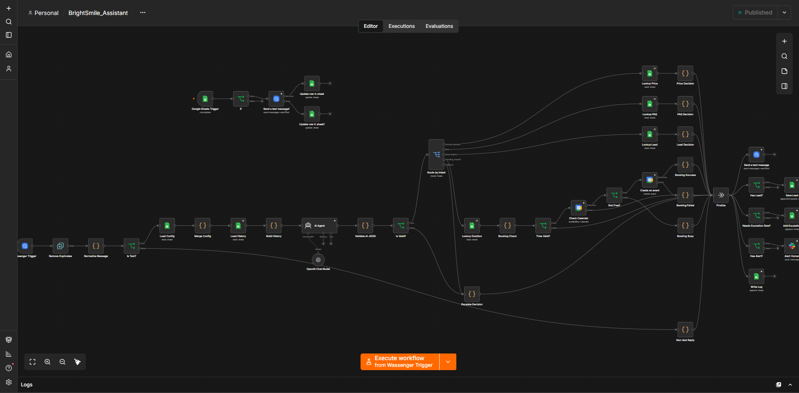
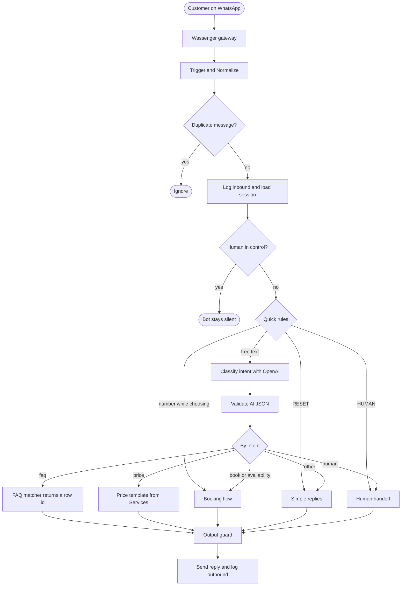
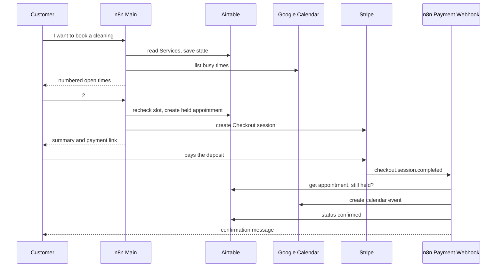
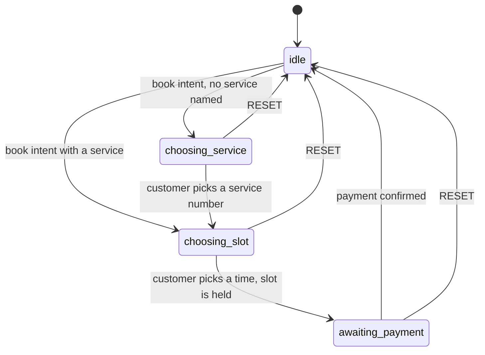

# Clinic Concierge

> A bilingual (English/Spanish) WhatsApp assistant that answers questions, quotes prices, books appointments and collects deposits for a service business. It runs on n8n, and **every price, policy and time slot comes from your own data, never from the AI's imagination.**

**Demo video:** [Watch the walkthrough (REPLACE_WITH_LOOM_URL)](REPLACE_WITH_LOOM_URL)  |  **Diagram:** [`docs/architecture.png`](docs/workflow-canvas.png)  |  **Runbook:** [`docs/runbook.md`](docs/runbook.md)  |  **Tests:** [`docs/test-results.md`](docs/test-results.md)



> **Portfolio project, not a client deployment.** This is a demonstration built from scratch around a fictional clinic ("BrightSmile Dental"). All names, prices, addresses and phone numbers are made up, and payments run in Stripe **test mode**. Nothing here has been used with real patients.

## Contents

1. [Why this exists](#why-this-exists)
2. [What it does](#what-it-does)
3. [Project status](#project-status)
4. [Architecture](#architecture)
5. [Design decisions](#design-decisions)
6. [Conversation flow](#conversation-flow)
7. [Data model](#data-model)
8. [Getting started](#getting-started)
9. [Example conversation](#example-conversation)
10. [Testing](#testing)
11. [Reliability and observability](#reliability-and-observability)
12. [Security and privacy](#security-and-privacy)
13. [Known limitations](#known-limitations)
14. [Roadmap](#roadmap)
15. [Adapting this to a client](#adapting-this-to-a-client)
16. [Repository structure](#repository-structure)
17. [About the author](#about-the-author)

## Why this exists

Small service businesses (clinics, home-service companies, salons) get most of their leads through WhatsApp, especially in Mexico and across Latin America, and they lose bookings when messages go unanswered after hours. An AI chatbot looks like the obvious fix, but a bot that invents a price or promises a time that is not free costs more than it saves.

This project is a worked answer to one question: **how do you put an LLM in front of customers without letting it be wrong about money and time?** The answer here is to use the model only to understand the message, and to let deterministic code and your own tables produce every fact that reaches the customer.

## What it does

| Capability | How it works |
|---|---|
| Answers FAQs in English and Spanish | The model picks the best matching row in a curated knowledge base. The **stored answer** is sent unchanged. |
| Quotes prices | The model identifies the service. A template fills in the price and deposit from the `Services` table. Prices that have not been re-verified recently are not quoted. |
| Shows open appointment times | Google Calendar and held slots are read. A code node builds the list from opening hours and service duration, in Central Time. |
| Books and holds a slot | A numbered-choice conversation, a re-check of the slot, then a 15-minute hold. |
| Collects a deposit | A Stripe Checkout link is sent in the chat. A payment webhook confirms the booking and creates the calendar event. |
| Captures leads | Each conversation updates a lead record with language, service interest and a simple score. |
| Hands off to a human | `HUMAN` pauses the bot for that chat and alerts the team. |
| Stays safe when unsure | Low confidence, bad AI output or a blocked reply produces a polite fallback and an offer of a human. |

## Project status

Tick only what you have built **and tested**. This table is the honest map of the project.

<!-- TODO before publishing: tick the boxes that are true for your build, delete this comment. -->

- [ ] Intake: webhook, normalization, deduplication, logging, conversation memory
- [ ] Language detection and intent routing with validated AI output
- [ ] FAQ answers from the knowledge base (EN/ES)
- [ ] Price replies from the Services table
- [ ] Availability and slot selection
- [ ] Slot hold and Stripe deposit link
- [ ] Payment webhook: confirm booking, create calendar event, notify customer
- [ ] Expire unpaid holds
- [ ] Output guard
- [ ] Error workflow with alerts
- [ ] Human handoff and lead scoring
- [ ] 24-hour reminders with approved templates
- [ ] Daily report

## Architecture

### Stack

| Layer | Tool | Role |
|---|---|---|
| Orchestration | n8n (self-hosted or cloud) | All workflows and business logic |
| WhatsApp | Wassenger (demo) | Receives messages by webhook and sends replies by API |
| AI | OpenAI small model (temperature 0) | Intent classification and FAQ row matching, JSON output only |
| Data and CRM | Airtable | Services, knowledge base, conversations, leads, appointments, logs, config |
| Calendar | Google Calendar | Busy times in, confirmed appointments out |
| Payments | Stripe Checkout (test mode) | Deposit link and payment webhook |
| Alerts | Telegram bot | Error notifications |

### Workflows

| Workflow | Trigger | Purpose |
|---|---|---|
| `01 Clinic Concierge: Main` | Incoming WhatsApp message | Intake, routing, handlers, output guard, send, log |
| `02 Stripe Payment Webhook` | `checkout.session.completed` | Confirms the booking when the deposit is paid |
| `03 Expire Holds` | Every 5 minutes | Releases unpaid held slots |
| `04 Daily Report` (optional) | Daily schedule | Summary of messages, leads, bookings, blocks, errors |
| `05 Reminders` (optional) | Every 30 minutes | 24-hour reminder using an approved WhatsApp template |
| `99 Error Handler` | Any workflow error | Logs to `Errors` and alerts the owner |

### Message flow



### Booking and payment sequence



## Design decisions

### 1. The AI is not the source of truth

**Problem:** language models state wrong prices and policies with total confidence.
**Decision:** the model never writes a fact. For FAQs it returns only a row ID and a confidence score, and the stored answer is sent word for word. For prices it returns only a service ID, and a template inserts the numbers from the table. Opening hours, deposit rules and policies live in tables a non-technical owner can edit.
**Trade-off:** replies are less free-form. In a booking assistant that is a feature, and the knowledge base is easy to extend.

### 2. An output guard checks every reply

**Problem:** even good systems fail, and a future change could let AI-written text through.
**Decision:** the last node before sending checks every dollar amount against the `Services` table, blocks discount and guarantee language, and rejects empty or oversized replies. On failure it sends a safe fallback and records the blocked text in the log.
**Trade-off:** a rare false block shows the fallback. That is far cheaper than a wrong quote.

### 3. Deduplication and idempotency

**Problem:** webhooks are delivered at least once, so the same message can arrive twice and trigger two replies or two bookings.
**Decision:** every inbound message ID is looked up in `Message_log` before anything else happens, then logged. Status events such as delivered and read are dropped at the first node.
**Trade-off:** one extra lookup per message, which keeps the bot predictable.

### 4. An explicit conversation state machine

**Problem:** a reply of "2" means different things at different moments.
**Decision:** the `Conversations.state` field stores where the customer is (`idle`, `choosing_service`, `choosing_slot`, `awaiting_payment`). Plain rules route bare numbers before the AI is involved. The AI only handles free text.
**Trade-off:** more explicit states to maintain, but behaviour is predictable and easy to test.

### 5. Slot holds with expiry

**Problem:** two people can pick the same time, and an unpaid booking must not block the calendar forever.
**Decision:** choosing a time re-checks it, creates a `held` appointment with an expiry time, and sends the payment link. Held slots are treated as busy. A scheduled workflow expires unpaid holds, and the payment webhook handles late payments explicitly by alerting the team instead of double-booking.
**Trade-off:** a short hold window and an extra scheduled workflow.

## Conversation flow



| State | Meaning | Next bare number means |
|---|---|---|
| `idle` | Nothing in progress | Treated as free text |
| `choosing_service` | The numbered service list was shown | A service |
| `choosing_slot` | Numbered times were shown | A time slot |
| `awaiting_payment` | Payment link sent | Treated as free text |

`RESET` returns to `idle` from any state.

## Data model

Airtable base `ClinicConcierge`. Seed data for three tables is in [`airtable/`](airtable/).

| Table | Purpose | Key fields |
|---|---|---|
| `Services` | Price list | `service_id`, `name_en`, `name_es`, `price_usd`, `duration_min`, `deposit_usd`, `active`, `last_verified` |
| `Knowledge_base` | FAQ answers | `kb_id`, `category`, `question_en`, `question_es`, `answer_en`, `answer_es`, `active` |
| `Config` | Settings | `key`, `value` |
| `Conversations` | The bot's memory | `phone`, `state`, `language`, `pending_service_id`, `pending_slots`, `pending_appointment_id`, `human_takeover` |
| `Leads` | Mini CRM | `phone`, `name`, `language`, `service_interest`, `score`, `status`, `last_seen` |
| `Appointments` | Bookings | `service_id`, `start_iso`, `end_iso`, `status` (held, paid, confirmed, cancelled, expired), `hold_expires_iso`, `stripe_session_id`, `calendar_event_id`, `deposit_usd` |
| `Message_log` | Audit trail | `message_id`, `phone`, `direction`, `text`, `intent`, `language`, `tool_used`, `guard_result`, `correlation_id`, `latency_ms` |
| `Errors` | Failures | `workflow`, `node`, `message`, `payload`, `resolved` |

Date and time fields are stored as ISO-8601 **text with a UTC offset** so time zones cannot shift silently.

## Getting started

### Prerequisites

- An n8n instance reachable over public HTTPS (n8n Cloud, or self-hosted behind a tunnel or reverse proxy)
- Accounts and keys for: Airtable, Google Cloud (Calendar API with OAuth), Stripe (test mode), OpenAI, and a WhatsApp gateway (Wassenger)
- Optional: a Telegram bot for error alerts

### Setup

1. **Airtable:** create a base `ClinicConcierge` with the tables above, then import `airtable/services.csv`, `airtable/knowledge_base.csv` and `airtable/config.csv`. Set `staff_alert_number` in Config to your own number.
2. **Credentials in n8n:** create credentials for Airtable, Google Calendar (OAuth2), the WhatsApp gateway, OpenAI and Stripe.
3. **Import workflows** from [`workflows/`](workflows/) in this order: `99-error-handler`, `01-main`, `02-stripe-payment-webhook`, `03-expire-holds`. Open every node showing a warning and re-select your credential, base, table and calendar. The exported files contain placeholders, not working IDs.
4. **Set the workflow timezone** to `America/Chicago` and set `99 Error Handler` as the error workflow in each workflow's settings.
5. **Activate** workflows 02 and 03 first, then 01.
6. **Smoke test:** send "hello" from a phone, then "I want to book", then pick a service and a time, and pay with Stripe test card `4242 4242 4242 4242`.

### Using the official WhatsApp Cloud API instead

The channel layer is isolated in two nodes (the trigger and the send node). To use Meta's WhatsApp Cloud API, replace those two nodes and keep `Normalize` mapping the incoming payload to the same fields. The rest of the system is unchanged.

## Example conversation

*Illustrative transcript of the designed behaviour. Replace it with a real screenshot from your own run.*

```text
Customer:  Hola, ¿cuánto cuesta una limpieza?
Bot:       *Limpieza dental*: $95 USD. Duración aproximada: 45 minutos. Un depósito de $20 reserva
           su cita y se descuenta de su cuenta final. [...] ¿Desea agendar?
Customer:  Sí, quiero agendar
Bot:       Para *Limpieza dental* (unos 45 min) estos horarios están libres (hora del Centro).
           Responda con el número:
           1. lun 12 oct, 9:00 a. m.   2. lun 12 oct, 12:00 p. m.   3. mar 13 oct, 9:00 a. m.
Customer:  2
Bot:       Resumen de su cita [...] Pague aquí para confirmar. Su horario está reservado por 15 minutos: <link>
```

## Testing

A 30-case test plan covers FAQs in both languages, price accuracy, the full booking path, adversarial messages (fake discounts, prompt injection, medical advice), and failure injection (bad AI key, duplicate webhooks, late payment).

Results are recorded in [`docs/test-results.md`](docs/test-results.md). 

## Reliability and observability

- **Retries:** external calls retry up to three times with a short wait.
- **Graceful degradation:** if the AI, calendar or payment step fails, the customer receives a calm fallback with an offer of a human, never silence.
- **Central error workflow:** every workflow reports failures to `Errors` and sends an alert.
- **Audit trail:** every inbound and outbound message is logged with its intent, the tool that produced the reply, the guard result, a correlation ID and latency.
- **Explicit edge cases:** duplicate webhooks, expired holds, late payments, non-text messages, and a human takeover that mutes the bot.

Operational procedures are in [`docs/runbook.md`](docs/runbook.md).

## Security and privacy

- No secrets are stored in the workflow files or this repository. Credentials live only in n8n.
- Raw n8n exports can contain pinned test data with real phone numbers and message text. Run the checker before every commit:

  ```bash
  python scripts/check_workflow.py workflows/*.json
  ```

  It flags keys, tokens, phone numbers, emails and pinned data. Use `--fix` to write a `.sanitized.json` copy with pinned data removed and identifiers replaced, then review the result yourself.
- Stripe runs in test mode only. Demo data is fictional.
- The bot only stores what it needs to run the conversation (phone, language, appointment details). Deletion of a customer's chat data is a manual step today.
- A real deployment needs customer consent, a privacy notice, a data-retention policy and review by the clinic's own compliance contact.

## Known limitations

These are stated openly because production systems have them too.

- **Slot re-check is exact-match.** It compares the chosen start time with other bookings made through the bot. Partially overlapping times and edits made directly in the calendar are not fully covered.
- **The WhatsApp gateway is a third-party service** used for the demo. A production clinic should use the official WhatsApp Cloud API with a verified business number and approved templates.
- **24-hour messaging window.** Free-form replies are only allowed within 24 hours of the customer's last message. Anything later, such as reminders, needs an approved template.
- **No reschedule or cancel flow yet.** The bot explains the policy and hands off to a person.
- **One clinic, one calendar, one time zone.** Opening hours are defined in code and config.
- **Simple knowledge base.** The FAQ fits in one prompt. A larger knowledge base needs proper retrieval.
- **Two languages.** English and Spanish only, with Spanish phrased in a neutral register.
- **Lead scoring is a simple points system,** not a trained model.
- **Human replies:** staff follow up by phone or a separate inbox. There is no shared inbox inside the chat.

## Roadmap

- Cancel and reschedule flow with the 24-hour policy applied automatically
- Overlap-safe availability checks and calendar-to-Airtable sync
- Approved reminder templates and no-show follow-up
- Official WhatsApp Cloud API channel with webhook signature verification
- Retrieval over a larger knowledge base, with source citations for staff
- Dashboard for the daily report
- An equivalent build in Make for teams that standardize on it
- Consent capture and one-command data deletion

## Adapting this to a client

| Change | Where |
|---|---|
| Services, prices, durations, deposits | `Services` table |
| FAQs and policies, in each language | `Knowledge_base` table |
| Hours, hold length, notice, booking window | `Config` table and the `Make Slots` code node |
| Brand voice and fallback wording | `Simple replies` and handler templates |
| Another language | Add `name_xx` and `answer_xx` columns and language handling |
| Another industry (roofing, solar, HVAC) | Replace services with job types and swap slots for site-visit windows |
| Different CRM | Replace the Airtable lead nodes with HubSpot, Pipedrive or similar |
| Different payments | Replace the Stripe request with Mercado Pago or another provider |

## Repository structure

```text
clinic-concierge/
|-- README.md
|-- LICENSE
|-- .gitignore
|-- airtable/              seed data: services, knowledge base, config
|-- docs/
|   |-- architecture.png   diagram (SVG source alongside)
|   |-- runbook.md         if X breaks, check Y
|   `-- test-results.md    30-case test plan and results
|-- scripts/
|   `-- check_workflow.py  secret and personal-data scanner
`-- workflows/             sanitized n8n exports (01, 02, 03, 99)
```

## About the author

Built by Ifedayo **Max** Fakayode, an AI automation engineer, as a demonstration of production-minded WhatsApp automation: grounded answers, safe failure modes and clear documentation.

- Contact: steven.fakayode@gmail.com
- Upwork: [Upwork Profile](https://www.upwork.com/freelancers/ifedayofakayodeai?mp_source=share)

## License

Released under the MIT License (see [`LICENSE`](LICENSE)). Replace the name placeholder in that file before publishing.
